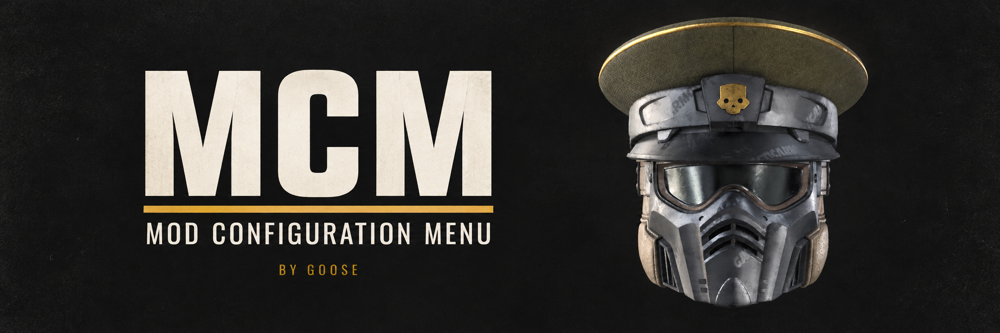

# DBF-MCM

**Divers' Best Friend — Mod Configuration Menu**, preview **0.1.59**, by **Goose**.
A shared in-game settings menu for Helldivers 2 mods.

[Nexus Mods](https://www.nexusmods.com/helldivers2/mods/17157) | [Ayaka](https://ayakamods.com/mods/dbf-mod-configuration-menu.4846/) | [GitHub downloads](https://github.com/HWG90/DBF-MCM/releases) | [Installation](docs/INSTALL-STANDALONE.md) | [Mod author quick start](docs/AUTHOR-GUIDE.md) | [API](docs/API.md) | [Credits](docs/CREDITS.md)

Photo-mode integrations can read a native real-time clock with `camera_input.now()`, even while simulation is paused or the photo menu has focus. Saved bindings and the shared input lease are preserved.

## UI polish pass

MCM now uses the game's main font, sliding On/Off switches, clearer inactive navigation and dropdowns without side selectors. Hovered controls keep their marks visible. Controls stay close to their labels as the window grows, with spare space used for setting details. Authored two-column pages keep their own layout and scrolling.

A pixel yellow skull and restrained hazard stripes finish the header and footer. Right-click a setting for its available actions. **Tab accepts an edit or applies pending changes**; **Shift+Tab** changes focus.

The console starts closed. Open it with **Console** or the grave/tilde key while MCM is open. Type for suggestions, use arrows to choose one, **Tab** to complete it and **Enter** to run it. Under LLL, MCM shares the loader's commands, diagnostics and log reader. Errors retain their mod owner; `verbose_registration` is an opt-in setting for registration details.

**DEL** opens/closes MCM by default and can be rebound in **Settings**. The native **MCM** Escape-menu tab also opens it. Settings includes window size, UI scale, font size, Reset Window and GitHub Page. Apply, Discard and Reset Setting are buttons. MCM does not pause gameplay.

## Installation

Choose one package and run one MCM instance.

| Download | Loader |
| --- | --- |
| **`DBF-MCM-Standalone-0.1.59.zip` — main file** | Bingus Shared Loader v15+ / API 1. Import into Arsenal, enable with Shared Loader, deploy and restart. |
| `ModConfigurationMenu-Preview-0.1.59.zip` — optional file | MDL API 2 **or** LLL R30+. Extract the complete `dbf_mcm` folder into your loader's Mods directory. |

**MDL and LLL use the same download. LLL does not require MDL.** Keep all packaged Lua files, the manifest, config, `library.txt` and native DLL together. Disable the previous MCM provider before switching. Restart after updating MCM.

LLL saves values in `%LOCALAPPDATA%/LLL/Helldivers2/Settings/dbf_mcm`, reading existing MDL values as fallback. MDL/Shared Loader retain `%LOCALAPPDATA%/MDL/Helldivers2/Mods/dbf_mcm/settings`. Mod-supplied storage providers, stable setting IDs and linked settings are preserved.

## For mod authors

Start with the [short working example](docs/AUTHOR-GUIDE.md). API 1 supports switches, explicit checkboxes, sliders, choices, keybinds, text, colors, actions, sections, pages and categories. Stable IDs identify saved values; failed saves leave values unchanged.

Source is split into registration/storage, preferences, controller, input, rendering, layout, styling, compatibility and platform modules. LLL loads the modules directly; MDL/Shared Loader use a generated bundle. See [architecture](docs/ARCHITECTURE.md) and [logging](docs/DIAGNOSTICS.md).

HUD+ 0.2.2 integration requires the local owner bridge in [integration setup](docs/INTEGRATIONS.md). Its code and assets are not included.

## Preview status

Main-font rendering and console behavior are confirmed in LLL. Layout, input, logging and package checks run offline; each loader still needs its own live validation. Controller navigation is not provided. See [release notes](docs/RELEASE-0.1.59.md).

Thanks to **Muchacho** for helping troubleshoot native keybinding lookup issues. MBM entries now use compact action/key rows and verified native key names. Custom-key name coverage and reported activation failures remain under investigation; the earlier F13 readout used the wrong key enum.
